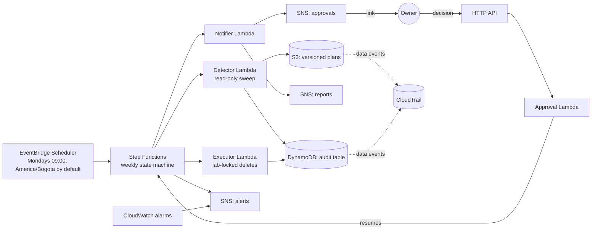
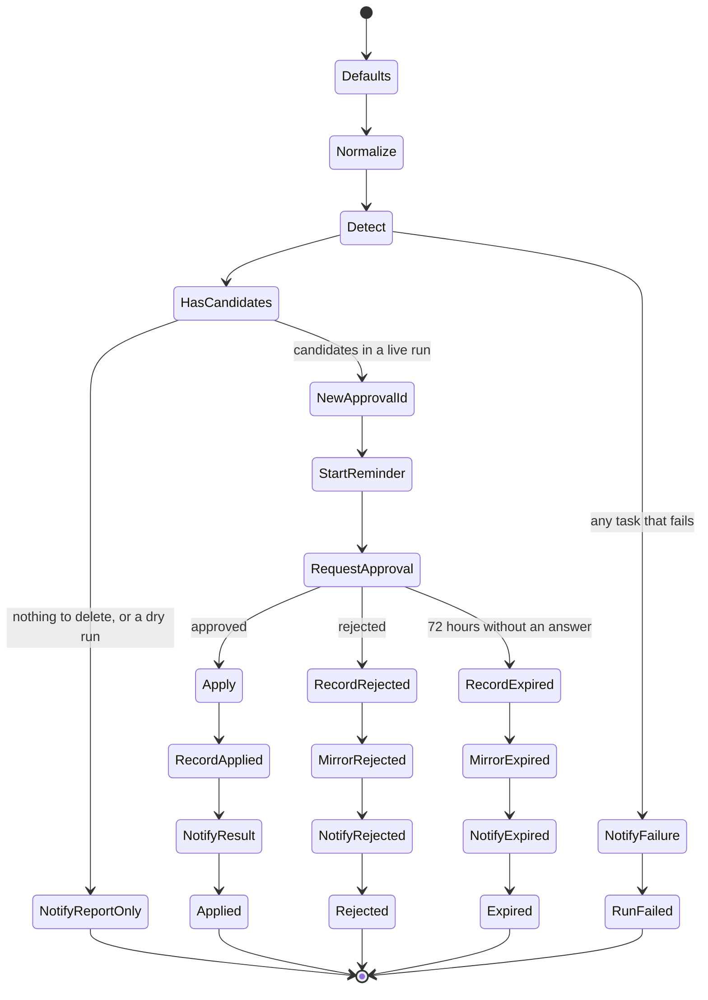

# aws-lab-janitor

[](https://github.com/MetMatDav/aws-lab-janitor/actions/workflows/ci.yml)
[](LICENSE)

A serverless janitor for an AWS account you learn and experiment in. Every
Monday it sweeps all enabled regions, emails a report of what is costing
money, and proposes a plan to delete the leftovers you marked as lab. Nothing
is deleted until you approve that specific plan, and what it can delete at all
is fixed by IAM: snapshots, unattached volumes, idle addresses, dashboards and
Internet Monitor monitors. Never an instance, a database or a bucket.

It runs in its author's account. On 2026-11-12 it deleted its first three
resources, decoys made for the purpose, after an approval by email, and left a
fourth alone because it carried the keep tag.
[The record of that run](docs/evidence/controlled-deletion-2026-11-12.md) is in
this repository.

## What it does



1. A schedule starts a Step Functions execution every Monday.
2. A read-only detector sweeps every enabled region and the global services,
   writes a plan (a JSON document identified by its sha256) to a versioned
   bucket, and records every finding in an audit table.
3. A notifier emails the report. If the plan has candidates for deletion, it
   also emails an approval request, and the execution waits up to 72 hours.
4. You open the link, read the plan, type a four-character code and approve or
   reject.
5. An executor with its own role applies exactly the plan you approved: it
   checks the plan's hash, re-reads each resource, deletes what still
   qualifies, and records each outcome. You get a result email.

Deployed as one AWS CDK stack (Python). In dry-run, which is the default, the
executor is disarmed and the weekly run only reports.

## How a deletion happens



Three things must all be true before anything is deleted:

- **The stack is armed.** It was deployed with `-c dryRun=false`. Otherwise the
  executor records every approved item as skipped.
- **The run is live.** Its input says `"dryRun": false`. A missing or mistyped
  value means dry-run.
- **You approved this plan**, within the last hour, and the plan the executor
  reads has the hash you approved.

And each resource passes a **double lock**. The code selects it: it carries the
lab mark, it does not carry `janitor=keep`, and the executor reads its live
state again right before deleting. IAM agrees independently: the executor's
role may delete only resources tagged `Purpose=lab` or named `LAB-...`, with an
explicit deny on anything tagged `janitor=keep`. A bug that picks a resource
without the lab mark, or one with the keep tag, ends in `AccessDenied`, not in
a deletion. The policy was checked against the IAM policy engine,
[22 simulated calls](docs/evidence/iam-simulation.txt); it has not yet been
seen denying a live call.

## What it detects

A resource counts as lab when its name starts with `LAB-` or it carries the tag
`Purpose=lab`. Everything below is reported whether it is lab or not, with an
estimated monthly cost where the price is fixed per hour or per gigabyte
(us-east-1 on-demand prices, dated in the plan). The janitor's own resources
and the CDK's bootstrap buckets are left out.

| Kind | What | Cost estimate |
| ---- | ---- | ------------- |
| `ec2-instance` | EC2 instance | no |
| `public-ipv4` | Auto-assigned public IPv4 addresses, counted per region | yes |
| `nat-gateway` | NAT gateway | yes |
| `elastic-ip` | Elastic IP address | yes |
| `ebs-volume` | EBS volume that is not attached | yes |
| `ebs-snapshot` | EBS snapshot | yes |
| `ami` | Machine image | no |
| `vpc-endpoint` | Interface VPC endpoint | yes |
| `elbv2` | Application or Network Load Balancer | yes |
| `rds-instance` | RDS database instance | no |
| `rds-cluster` | RDS or Aurora cluster | no |
| `elasticache` | ElastiCache cluster | no |
| `internet-monitor` | Internet Monitor monitor | no |
| `s3-bucket` | S3 bucket | no |
| `cloudfront` | CloudFront distribution | no |
| `cw-dashboard` | CloudWatch dashboard | no |

Anything else in the account is not seen: Lambda functions, EKS, OpenSearch,
Kinesis and the rest are outside the sweep.

## What it can delete, after approval

| Kind | Proposed when | Minimum age |
| ---- | ------------- | ----------- |
| `ebs-snapshot` | Tagged `Purpose=lab`, completed, not backing any machine image | 7 days |
| `ebs-volume` | Tagged `Purpose=lab`, not attached | 7 days |
| `elastic-ip` | Tagged `Purpose=lab`, not associated, and already seen that way by an earlier live run | 7 days between the two runs |
| `cw-dashboard` | Named `LAB-...` | none: proposed the first time it is seen |
| `internet-monitor` | Named `LAB-...` | none: proposed the first time it is seen |

A resource tagged `janitor=keep` is never proposed. The tag must match exactly:
`Janitor=keep` or `janitor=Keep` do not protect anything.

## What it never touches

| Kind | Why |
| ---- | --- |
| `ec2-instance` | Compute: no role in the stack holds a terminate or stop action |
| `rds-instance` | Data: no role holds a delete action for it |
| `rds-cluster` | Data |
| `elasticache` | Data |
| `s3-bucket` | Data |
| `ami` | A restore point: never proposed, and the snapshots behind it are skipped too |
| `elbv2` | In front of compute that may still serve traffic |
| `nat-gateway` | Removing it changes the routing of a network |
| `vpc-endpoint` | Removing it changes the routing of a network |
| `cloudfront` | Serves traffic |
| `public-ipv4` | Belongs to a network interface that is in use |

These are reported, with a cost estimate where the price is fixed, so that you
delete them yourself, knowing what they are. This is not a setting: the permissions do not exist
([ADR 0006](docs/adr/0006-never-delete-compute-or-data.md)).

## Try it in dry-run

You need Python 3.13 with [uv](https://docs.astral.sh/uv/), Node 22 and an AWS
account. Replace `ACCOUNT_ID`, the profile and the address:

```
make install
export AWS_PROFILE=your-profile AWS_REGION=us-east-1 PATH="$PWD/.venv/bin:$PATH"
npx cdk bootstrap aws://ACCOUNT_ID/us-east-1    # once per account and region
npx cdk deploy LabJanitorStack --require-approval broadening \
  -c reportEmail=you@example.com -c reservedConcurrency=false
```

Confirm the three subscription emails SNS sends you (reports, approvals,
alerts). Then start a run without waiting for Monday, with the state machine
ARN from the stack outputs:

```
python -c "import boto3; print(boto3.client('stepfunctions', region_name='us-east-1').start_execution(stateMachineArn='STATE_MACHINE_ARN', input='{\"dryRun\": true, \"minAgeDays\": 7}')['executionArn'])"
```

A report arrives by email in about half a minute. Nothing can be deleted in
this state. To arm it, redeploy with `-c dryRun=false`; from then on the Monday
run asks for your approval when it finds something.

Three things to know before you deploy. By default the stack creates its own
CloudTrail trail with management events; in an account that already has a
trail, add `-c createTrail=dataEventsOnly` so you do not pay for a second copy.
The heartbeat alarm of a new stack fires once, until the first run. And
`cdk destroy` keeps the plans bucket, the trail's log bucket and the audit
table: they are the record.

`-c reservedConcurrency=false` is for new accounts, whose Lambda concurrency
quota is too small to reserve any. The [runbook](docs/runbook.md) covers the
rest: every setting, approving and rejecting, what each alarm means, pausing,
CloudTrail, troubleshooting.

## What it costs

About 50 cents a month, at one run a week in us-east-1 with
`createTrail=dataEventsOnly`, before any free tier (prices read from the AWS
price list on 2026-11-12):

- Four CloudWatch alarms watching five metrics, at $0.10 per metric: $0.50.
- Lambda: about 25 seconds a week at 512 MB on arm64, less than a tenth of a
  cent a month.
- CloudTrail data events: a few dozen per run at $1 per million.
- Step Functions transitions, DynamoDB writes, S3 storage, SNS emails and API
  calls are priced per request and used a few dozen times a week.

One NAT gateway left running costs $32.85 a month.

## Evidence

- [Sixteen weekly runs](docs/evidence/legacy-weekly-runs.md) of the first
  version of this janitor, July to November 2026, read from its logs.
- [A real deletion](docs/evidence/controlled-deletion-2026-11-12.md): three
  decoys approved and deleted, one kept, with the CloudTrail events and the
  [audit items](docs/evidence/controlled-deletion-2026-11-12-audit.json) of
  the run, and [the report](docs/evidence/report-2026-11-12.txt) it emailed.
- [A false alarm](docs/evidence/alarm-history-2026-11-12.json) on a delivered
  email, found in a rehearsal, and
  [the design change](docs/adr/0012-refuse-to-publish-instead-of-alarming-on-delivery.md)
  it caused.
- [An approval nobody answered](docs/evidence/expiry-2026-11-14.md): it
  expired after 72 hours and nothing was deleted.
- [A security audit](docs/evidence/security-audit-2026-11-18.md) before
  publication: nothing confirmed, two leads, one fixed and one written up as a
  limitation.
- The first scheduled run with deletions armed, on Monday 2026-11-16: it
  started by itself, found nothing to delete and emailed its report.
- Rehearsals of approval, rejection, a wrong code, the reminder and a failed
  run, recorded in the [runbook](docs/runbook.md#dress-rehearsal-with-deletions-disabled).

## How it is tested

Five suites ask five questions: does each function do what was meant
(examples against recorded AWS responses), is the infrastructure what the
design says (assertions on the synthesized template, cdk-nag in strict mode),
what can someone else make it do (an adversarial suite with three footholds),
does it hold for every input (property tests, including a state machine over
the approval record), and do these documents still describe the code. Known
defects stay in the suite as tests that fail on purpose.

Before deletions were enabled, the code went through two independent review
passes. One found that no test was property-based and, with random inputs,
three defects that examples had missed. The other attacked the code and found
no way to delete outside an approved plan, and fifteen other defects, twelve
fixed the same day. [docs/testing.md](docs/testing.md) has the detail,
including what never ran against a real account.

## Limits

- **It is for one account and one owner.** No Organizations support, no
  multi-account view.
- **Four known limitations**, each with a test that fails on purpose and the
  change it would take: the approval id can be read by anyone who can read the
  audit trail of the account, someone who can invoke the approval function
  directly can pass as the IAM approver, and the detector and the executor run
  out of time with thousands of resources.
  [docs/known-limitations.md](docs/known-limitations.md).
- **Not everything has run live.** The approval route authenticated with IAM
  and the deletion of addresses and monitors are covered by tests against
  recorded responses only. The IAM half of the double lock was simulated
  against the policy engine and never seen denying a live call. The quickstart
  above has not been repeated from a fresh account.
  [The full list](docs/testing.md#what-never-ran-live).
- **Costs are estimates** from a price table for us-east-1, not from Cost
  Explorer, and only for resources with a fixed hourly or per-gigabyte price.
- The [threat model](docs/threat-model.md) says what each component could do
  in the worst case.

## Why not aws-nuke, cloud-nuke or Cloud Custodian

They solve different problems, and for theirs they are the better tools.

- **aws-nuke** removes every resource from an account. It is for accounts you
  want empty.
- **cloud-nuke** is a command-line tool that deletes all resources in an
  account, with a dry-run flag, a confirmation prompt and a configuration file
  to narrow what it touches. A person runs it.
- **Cloud Custodian** is a rules engine: policies written in YAML select
  resources with filters and act on them, on a schedule or in response to
  events. It can do far more than this project, across clouds.

This project is for an account that is still in use. It never empties
anything: it can delete five kinds of leftovers and nothing else. It runs by
itself every week, and each deletion waits for a person to approve one stored,
hashed plan. What it found, what was proposed, who approved and what happened
are kept as a record.

## How it was built

By Mateo Cortés, who designed it, decided what it must never do, and reviewed
each plan and each result, with Claude (Anthropic) as a coding agent writing
the code, the tests and these documents under that direction. The process is
in the repository:

- [The design](docs/superpowers/specs/2026-11-02-lab-janitor-portfolio-design.md),
  with a last section listing what changed while building.
- [Four implementation plans](docs/superpowers/plans/) and the
  [follow-ups file](docs/superpowers/plans/2026-11-03-plan-1-followups.md),
  which records every review finding and what was done about it.
- [Fourteen decision records](docs/adr/README.md).
- [The runbook](docs/runbook.md), with the record of each rehearsal.

## License

[MIT](LICENSE).
