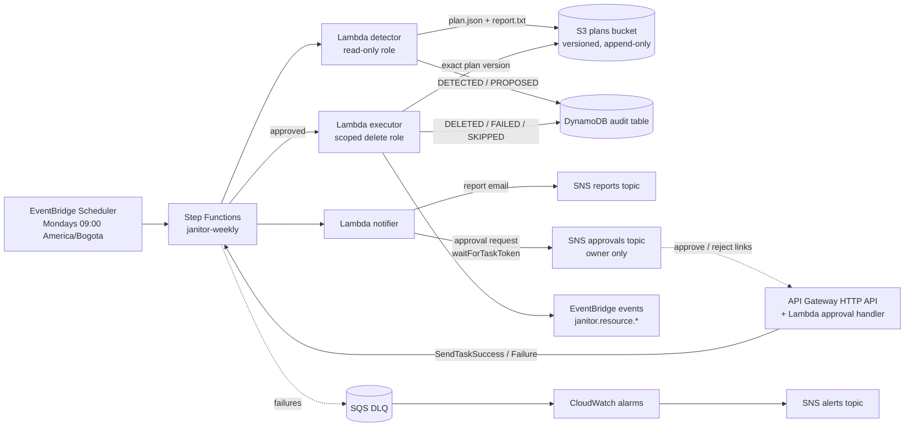

# Lab Janitor: portfolio release design

Date: 2026-11-02
Status: v4, built and deployed; section 12 lists what changed while building
Author: Mateo Cortés (with Claude)

## 1. Intent and why

The janitor is a serverless sweeper for a personal AWS lab account. Every Monday a Lambda scans all enabled regions plus global services, reports billable resources by email, and deletes lab leftovers. It has run weekly since 2026-07-27 (13 consecutive weekly runs, zero errors, about 24 seconds each) but the delete path has never fired on a real resource.

The owner wants to turn it into a portfolio piece for an international audience. An external reviewer of the current repo sees a `cdk init` README, one empty test, personal data hardcoded in the stack, and a delete model where an email arrives *after* resources are gone. The engineering underneath (least-privilege IAM "double lock", bounded retries, shared DLQ with alarm, shared boto3 session) is sound and was validated by an independent audit on 2026-11-01 against official docs, cfn-lint, cfn-guard and cdk-nag.

This release does three things:

1. Replaces "delete, then email" with **plan, explicit approval, apply**: the email becomes a notification, a human approves an immutable plan, and a separately-scoped executor applies exactly that plan. Every step is recorded.
2. Fixes the confirmed defects of the detector (silent errors, dishonest counters, no minimum age, inconsistent lab marking, stale IPv4 pricing).
3. Packages the project for readers: English README with diagram, ADRs, runbook, tests, CI, evidence of real operation, clean public repo.

The janitor keeps running live in the owner's account throughout, so the repo is also its operational source of truth.

## 2. Goals, non-goals, anti-goals

**Goals**

- A reviewer with three minutes understands what it is, what it deletes, what it never touches, and that it runs for real.
- A reviewer with twenty minutes finds tests that prove the security claims, ADRs that explain the decisions, and an audit trail design they would accept at work.
- No deletion happens without an explicit, recorded human approval of a specific plan.
- Full traceability: for every resource the janitor ever touched, the repo's design answers *who decided, when, why, and what happened*.
- Failures are never silent: a run that does not happen, a detector that cannot read a service, or an email that SNS cannot hand to the mail provider each produce a visible signal.
- Safe by default for anyone who clones it: dry-run unless explicitly disabled, no personal data, deployable into any account.

**Non-goals**

- Covering every AWS service. Coverage grows by exactly three detectors (Aurora clusters without instances, interface VPC endpoints, registered AMIs). Everything else is listed as "not detected" in the README.
- Multi-account or AWS Organizations support.
- Real cost from Cost Explorer. Cost figures stay as a documented on-demand price table.
- A web UI. Approval is an email with two links and a confirmation page.
- Replacing the email channel. Slack or ticketing integrations are described as extension points, not built.

**Anti-goals** (the project fails if any of these happen, even if everything else works)

- Deleting compute or data stores (EC2, RDS, ElastiCache, S3, load balancers), ever, by any path. Guaranteed by IAM: no role has those actions.
- Deleting anything that was not in the approved plan, or that no longer matches the criteria at apply time. IAM cannot express "in the plan"; this is guaranteed by executor code (iterates only plan items, re-verifies each) plus the plan hash check, and the threat model says so.
- Approval by accident: a link prefetched or rendered by a mail scanner must not approve anything. Guaranteed by: GET is side-effect free, POST requires a human-typed confirmation, no JavaScript on the page.
- Hardcoded account id, email or secrets anywhere in the published repo or its history.

## 3. Constraints

- Language: everything in the repo (code, comments, commits, docs, report text, resource names) in English.
- New repository with clean history. The current local repo stays as a private reference.
- Infrastructure as code with AWS CDK v2 in Python. Python **3.13 everywhere**: Lambda runtime, `.python-version`, CI, `requires-python`. No "newest available" logic in the stack.
- boto3 from the Lambda runtime, no bundling. Assets exclude `__pycache__` and `*.pyc`.
- Cost must stay at cents per month (Step Functions Standard, DynamoDB on-demand, S3, SNS, one HTTP API).
- Deployable with `cdk deploy` into any account by setting context values; `cdk synth` and the test suite must run without AWS credentials.
- No em dashes in AWS resource names or descriptions (hyphens only).
- Secrets: none are needed; if a shared secret ever becomes necessary it goes in Secrets Manager and is resolved at runtime, never committed.

## 4. Architecture

### 4.1 Overview



Three SNS topics, each with one purpose:

- `reports`: weekly report and run results. Anyone the owner wants informed may subscribe.
- `approvals`: approval requests with the approve/reject links. **Every subscriber of this topic is an approver**, so its topic policy allows `sns:Subscribe` only to the owner's identity and `sns:Publish` only to the notifier role.
- `alerts`: alarms and failures. Can later go to a pager without touching the others.

An accidental unsubscribe from reports therefore silences neither approvals nor alerts.

### 4.2 State machine `janitor-weekly` (Standard workflow)

Execution input is normalized first so that a missing or mistyped field can never take the live path.

| State | Type | What it does | On failure |
|---|---|---|---|
| Normalize | Pass | Produces `$.config = {dryRun: <bool, default true>, minAgeDays: <int, default from context>}`; only an explicit boolean `false` yields `dryRun: false` | |
| Detect | Lambda `detector` | Sweeps regions and globals; writes `plans/<runId>/plan.json` and `plans/<runId>/report.txt` to S3; writes one DETECTED record per finding, one PROPOSED record per candidate and one ELIGIBLE record per idle, lab-tagged, unkept Elastic IP (all carrying `dryRun`); returns a **compact** result `{runId, planVersionId, planSha256, reportVersionId, candidateCount, errorCount, estimatedMonthlyUsd}` (no report text, no candidate list: Step Functions caps state payloads at 256 KiB) | Catch → NotifyFailure |
| HasCandidates | Choice | `$.config.dryRun == false` **and** `candidateCount > 0` → RequestApproval; anything else → NotifyReportOnly | |
| NotifyReportOnly | Lambda `notifier` (mode `report`) | Reads `report.txt` from S3, truncates to 150 KB with a pointer to S3, publishes to `reports` (subject says DRY RUN when applicable) | Catch → NotifyFailure |
| RequestApproval | Lambda `notifier` (mode `approval`) with `.waitForTaskToken`, `TimeoutSeconds` 72 h, `ResultPath: $.approval` | Reads `plan.json` at `planVersionId`, recomputes sha256 and compares with Detect's value, builds a compact plan summary, writes the approval record (section 4.5) with `expiresAt` = now + 71 h 30 min, publishes to `approvals` (summary, sha256, links) and the report to `reports` | Timeout → RecordExpired → NotifyExpired (`reports`) → Succeed |
| RecordRejected | DynamoDB `updateItem` integration | Marks the approval record REJECTED if the handler has not already (idempotent) and writes the `RUN#<runId>/APPROVAL#<id>` mirror event | → NotifyRejected (`reports`) → Succeed |
| Apply | Lambda `executor` | Input: Detect result plus `$.approval`; derives the key `plans/<runId>/plan.json` from `runId`, reads **exactly** `planVersionId`, checks sha256 against both Detect's value and the approval record, requires `$.config.dryRun == false` and its own `DELETIONS_ENABLED=true` environment flag, re-verifies each item, deletes, writes DELETED / FAILED / SKIPPED, emits events, returns per-resource counts | Catch → NotifyFailure |
| RecordApplied | DynamoDB `updateItem` integration | Writes the `RUN#<runId>/RUN#SUMMARY` record with counts and approver metadata | |
| NotifyResult | Lambda `notifier` (mode `result`) | Email to `reports` with deleted / failed / skipped and the approver identity (source IP, user agent, time) | → Succeed |
| NotifyFailure | SNS publish to `alerts` | Run id, failed state, error | → Fail |

Because `ResultPath: $.approval` keeps the callback output in its own field, the approval handler cannot alter `runId`, `planVersionId` or `planSha256`; the detector's output stays authoritative for Apply.

Manual runs: `StartExecution` with `{"dryRun": true|false, "minAgeDays": N}` for one-off runs; the runbook documents it and warns not to overlap the Monday window.

Every `LambdaInvoke` task carries a Retry on `Lambda.TooManyRequestsException` (30 s, backoff 2, 5 attempts) in addition to the default service-exception retry, because the detector and executor have reserved concurrency 1 and Scheduler delivery is at-least-once.

### 4.3 Approval handler (API Gateway HTTP API + Lambda)

- `GET /approvals/{id}` renders a small HTML page from the approval record only: plan summary, sha256, expiry, and one form with an Approve button, a Reject button and a text field asking for the **last four characters of the run id** shown in the email. **No state changes on GET**: mail scanners and link previews prefetch links; prefetching must be harmless. The page has no JavaScript, no external assets, `Cache-Control: no-store`, `Referrer-Policy: no-referrer` and a strict CSP.
- `POST /approvals/{id}` performs the decision with this exact sequence:
  1. `UpdateItem` with `ConditionExpression status = PENDING AND expiresAt > :now`, setting `status = DECIDING` plus approver metadata (ip, user agent, time). `ConditionalCheckFailed` → `409` if already decided, `410` if expired.
  2. Verify the typed confirmation; on mismatch revert to PENDING and return `400`.
  3. `SendTaskSuccess` (approve, output `{"decision":"approved","approvedBy":{...}}`) or `SendTaskFailure(error="Rejected")`. On `TaskTimedOut` set `status = EXPIRED` and return `410`; on any other error revert to PENDING and return `500`.
  4. Finalize `status = APPROVED` or `REJECTED`. A second POST on a decided record returns `409`.
- The approval id is 32 random bytes (base64url). The task token itself never leaves DynamoDB. Possession of the approval email equals authority to approve: this is the documented limitation of the link mode (threat model + ADR-0008). Forwarding the email is delegating approval.
- Logging: the handler logs a hash of the approval id, never the id; API access logs omit the path; log groups keep 90 days.
- `states:SendTaskSuccess` and `states:SendTaskFailure` do not support resource-level permissions, so the handler policy uses `Resource: "*"`; the real capability is the token, which only this handler can read (section 4.7).
- **IAM-authenticated approval** (owner decision): the same handler also serves `POST /iam/approvals/{id}` on a route with `AWS_IAM` authorization. The caller signs the request with SigV4 using their own AWS identity (the repo ships a tiny CLI, `scripts/approve.py`, that takes the approval id and `approve|reject`); the audit record then stores the real principal ARN from `requestContext.identity` instead of ip and user agent, and no typed confirmation is needed. HTTP APIs have no resource policies, so the route is protected twice: API Gateway requires a valid SigV4 signature from a principal allowed to call `execute-api:Invoke`, and the handler compares the caller's principal (`requestContext.authorizer.iam.userArn`, an `assumed-role` ARN) with the role named by context `approverRoleArn`; any other principal gets `403` and no state changes. Context `approvalAuth` selects `link` (default: email carries links), `iam` (email carries the CLI command, no links), or `both`. All three modes are built and tested in this release; the quickstart uses `link`.
- Default `execute-api` host, `$default` stage, stage throttle 10 requests per second. A custom domain is an extension point in ADR-0008.
- Reserved concurrency is **not** set on the handler or the notifier (scanner bursts would turn into 5xx for the human). It is set to 1 on the detector and the executor only, where it is a safety property.

### 4.4 Plan file

`plans/<runId>/plan.json`:

```json
{
  "runId": "20261110T140012Z-7f3a",
  "generatedAt": "...",
  "dryRun": false,
  "criteria": {"tagKey": "Purpose", "tagValue": "lab", "namePrefix": "LAB-", "keepTag": "janitor=keep", "minAgeDays": 7},
  "candidates": [
    {"region": "us-east-1", "kind": "ebs-snapshot", "resourceId": "snap-0abc", "arn": "arn:aws:ec2:us-east-1::snapshot/snap-0abc",
     "reason": "tag Purpose=lab, 42 days old, not referenced by any AMI", "ageDays": 42, "estimatedMonthlyUsd": 0.4}
  ],
  "inventory": [ "... findings without deleter, with age and estimated fixed cost ..." ],
  "errors": [{"region": "ap-east-2", "service": "internetmonitor", "error": "EndpointConnectionError", "classification": "service-unavailable-in-region"}]
}
```

The detector returns the S3 `VersionId` of the object it wrote; the notifier and the executor read that exact version, so a later write to the same key cannot change what was approved or applied.

Plans bucket: versioning on, Block Public Access, `BucketOwnerEnforced`, TLS-only policy, `RemovalPolicy.RETAIN`, no `auto_delete_objects`. Lifecycle: current versions expire after 400 days, noncurrent versions after 30 days. Bucket policy statements:

- Deny `s3:DeleteObject` and `s3:DeleteObjectVersion` on `plans/*` to every principal except the account root user (owner decision), expressed as `Principal: "*"` with `Condition StringNotEquals aws:PrincipalArn = arn:aws:iam::<account>:root` (S3 does not support wildcards in `NotPrincipal`). The owner operates through SSO roles, so in practice plans are removed only by lifecycle or by a deliberate root-user session, which CloudTrail records.
- Deny `s3:PutObject` on `plans/*` to every principal except the detector role.

This is **tamper-evident, not tamper-proof**: an administrator can still change the policy or the lifecycle, and CloudTrail records that. S3 Object Lock is the upgrade path (ADR-0007).

### 4.5 Audit table

DynamoDB on-demand, table `janitor-audit`, point-in-time recovery on. Two item families separated by partition-key prefix so IAM can confine each role with `dynamodb:LeadingKeys`:

| Family | `pk` | `sk` | Written by |
|---|---|---|---|
| Run events | `RUN#<runId>` | `RESOURCE#<region>#<kind>#<resourceId>#<EVENT>` (the kind keeps a bucket and a dashboard with the same name apart), `APPROVAL#<approvalId>` (mirror), `RUN#SUMMARY` | detector, executor, state machine |
| Approval | `APPROVAL#<approvalId>` | `META` | notifier (create), handler (status transitions), state machine (expiry) |

Run-event attributes: `event` (DETECTED, PROPOSED, ELIGIBLE, DELETED, FAILED, SKIPPED), `at`, `actor` (`lambda:detector`, `lambda:executor`), `dryRun`, `kind`, `region`, `detail` (reason, error code, estimated cost, plan sha256), `resourceId` (GSI key, sorted by `at`).

Approval attributes: `runId`, `planVersionId`, `planSha256`, `planSummary` (bounded, well under the 400 KB item limit), `taskToken`, `status` (PENDING, DECIDING, APPROVED, REJECTED, EXPIRED), `expiresAt`, `approvedBy`, `ttl` (30 days after expiry).

Write rules: every run event is a **conditional put** (`attribute_not_exists(pk) AND attribute_not_exists(sk)`), so no role can overwrite history; the only `UpdateItem` calls are the approval status transitions. A GSI on `resourceId` answers "what has the janitor ever done to snap-0abc".

External evidence: CloudTrail Event history shows 90 days of management events (every `DeleteSnapshot`, `ReleaseAddress`, `SendTaskSuccess`, `StartExecution`). DynamoDB item writes and S3 object writes are data events and need a trail. Owner decision: **check what exists, then create one**. Phase 0 runs `describe-trails --include-shadow-trails` in the account; if an organization or account trail already delivers management events to S3, the stack adds only an **event data store or trail for data events** on the plans bucket and the audit table (context `createTrail=dataEventsOnly`); if nothing exists, the stack creates a multi-region trail with management events plus those data events (`createTrail=full`), with its own log bucket (TLS-only, versioned, 400-day lifecycle). `createTrail=none` remains available for cloners who do not want the cost. The runbook includes the `lookup-events` query for the executor role and the Athena-free way to read the trail files for a given run id.

### 4.6 EventBridge events

The executor emits one event per resource on the default bus: source `lab-janitor`, detail-type `janitor.resource.deleted|failed|skipped`, detail = the audit record. The repo ships no consumer; this is the extension point for Slack, ticketing or a data lake.

### 4.7 IAM: who can do what

| Role | Allowed | Explicitly cannot |
|---|---|---|
| detector | the existing enumerated Describe*/List* set plus `rds:DescribeDBClusters`, `rds:ListTagsForResource`, `elasticloadbalancing:DescribeTags`, `elasticache:ListTagsForResource`, `s3:GetBucketTagging`, `ec2:DescribeVpcEndpoints`, `ec2:DescribeImages`, `ec2:DescribeNetworkInterfaces`, `cloudwatch:ListTagsForResource`, `internetmonitor:ListTagsForResource`; `s3:PutObject` on `plans/*`; `dynamodb:PutItem` with `LeadingKeys RUN#*`; `dynamodb:Query` on the `resourceId` GSI (EIP age rule) | any Delete*, Release*, Tag*, SNS publish, UpdateItem, reading approval records |
| notifier | `s3:GetObject`/`GetObjectVersion` on `plans/*`; `sns:Publish` on `reports` and `approvals`; `dynamodb:PutItem` with `LeadingKeys APPROVAL#*` | anything on AWS resources, reading run events |
| approval handler | `states:SendTaskSuccess`, `states:SendTaskFailure` (`Resource: "*"`, no resource-level support); `dynamodb:GetItem`/`UpdateItem` with `LeadingKeys APPROVAL#*` | start executions, read plans, read run events |
| executor | the double-locked deletes (`cloudwatch:DeleteDashboards` on `dashboard/LAB-*`; `internetmonitor:UpdateMonitor`/`DeleteMonitor`/`GetMonitor` on `monitor/LAB-*`; `ec2:DeleteSnapshot`, `ec2:DeleteVolume`, `ec2:ReleaseAddress` scoped to `snapshot/*` (no account id in that ARN), `volume/*`, `elastic-ip/*` with `aws:ResourceTag/Purpose = lab`); an explicit **Deny** on all of them when `aws:ResourceTag/janitor = keep`; optionally `aws:RequestedRegion` limited to the regions the lab uses (context list); the Describe/ListTagsForResource calls needed to re-verify those resource types; `s3:GetObjectVersion` on `plans/*`; `dynamodb:PutItem` with `LeadingKeys RUN#*`; `events:PutEvents` | listing resources, SNS publish, Tag*, UpdateItem |
| state machine | `lambda:InvokeFunction` on detector, notifier and executor only; `sns:Publish` on `alerts`; `dynamodb:UpdateItem` with `LeadingKeys APPROVAL#*` and `PutItem` with `LeadingKeys RUN#*` (Record* states) | invoking the approval handler, reading plans |
| scheduler | `states:StartExecution` on the state machine; `sqs:SendMessage` on the DLQ | |

Residual risk, stated in the threat model: by IAM alone the executor may delete any lab-tagged snapshot, volume or EIP and any `LAB-*` dashboard or monitor in the allowed regions; **code bounds it to the approved plan**, and a Stubber test asserts that no delete call is made for an id absent from the plan.

The marker constants (`LAB_NAME_PREFIX`, `LAB_TAG_KEY`, `LAB_TAG_VALUE`, keep tag) stay defined once in the CDK app and flow into both environment variables and policies, as today.

### 4.8 Detector behavior changes

- **Visible errors.** Every service block goes through one `safe(region, service, fn)` helper that records an error finding and a structured warning log. Errors are classified: `access-denied`, `service-unavailable-in-region` (EndpointConnectionError or `Not Found` for services absent in opt-in regions), `throttled`, `other`. The report lists them by region and service and never prints "account clean" when errors exist.
- **Per-call isolation in EC2.** Instances, NAT gateways, addresses, volumes and snapshots each run in their own `safe` block.
- **Uniform marking.** `is_lab(name, tags)` for every type; RDS uses `TagList`, ELBv2 uses `DescribeTags` in batches of 20 ARNs, ElastiCache uses `ListTagsForResource`, S3 uses `GetBucketTagging` (NoSuchTagSet handled). Candidates for deletion still require the tag only, matching IAM. Dashboards and monitors are candidates by `LAB-` name prefix; their tags are read with `ListTagsForResource` only to honor the keep tag.
- **Minimum age.** `minAgeDays` (default 7) from `Snapshot.StartTime` and `Volume.CreateTime`; volumes must be `available`. It does not apply to dashboards and monitors (no creation timestamp in the list calls), which the README states. EIPs have no timestamp, so the audit table supplies one: every run writes an ELIGIBLE event for each idle, lab-tagged, unkept EIP that has an allocation id (the event carries `dryRun`). An EIP is a candidate only when a **non-dry-run** ELIGIBLE record exists for it whose `at` is at least `minAgeDays` days before the current run (GSI query on `resourceId` with `at < now - minAgeDays`). Its age therefore counts from the first live run that saw it idle; dry-run records never count, and a run with `minAgeDays=0` accepts any earlier live record.
- **AMI exclusion.** Snapshots referenced by `DescribeImages(Owners=self)` block device mappings are reported as "backs AMI ami-xxx" and never proposed.
- **Keep tag.** Any resource tagged `janitor=keep` is reported and never proposed (and IAM denies it anyway).
- **IPv4.** Every public IPv4 (EIPs idle or associated, instance public IPs, NAT and load balancer addresses via `DescribeNetworkInterfaces`) is counted at the current public IPv4 price. The EIP detail no longer implies that associated addresses are free.
- **Age and cost on every finding**, from fields already in the responses. Prices live in one table `FIXED_HOURLY_USD` with a date and region note; the report header shows the estimated fixed monthly cost of everything detected.
- **Report layout.** ACTIONABLE (candidates with reason) first, then INVENTORY grouped by type, then ERRORS, then regions with nothing found. The full report lives in S3; the notifier truncates the email at 150 KB with a pointer.
- **botocore Config.** `connect_timeout=5`, `read_timeout=20`, `retries={"mode": "standard", "max_attempts": 3}` on every client; a per-region time budget derived from `context.get_remaining_time_in_millis()`.
- **Structured logging.** `logging` with JSON format from the Lambda logging config; every record carries `runId`.
- **Configuration.** A frozen `Settings` dataclass built inside the handler from the event and environment, so tests can vary dry-run and thresholds without reloading modules.
- **Local run safety.** The detector's `__main__` block runs detection only and writes the plan to stdout; there is no local entry point to the executor.

### 4.9 Executor behavior

The executor never lists resources; it iterates plan items only. Before anything: `DELETIONS_ENABLED` must be `true` and the input `dryRun` must be `false`, otherwise every item is SKIPPED `deletions-disabled`. For each item, in order: load the current state of that single resource (describe by id, read its tags); re-check tag, keep tag, state, age and AMI references; if anything changed, write SKIPPED with the reason; otherwise delete, write DELETED or FAILED (with the AWS error code), log before and after each call, emit the event. The executor stops early and marks remaining items SKIPPED `time-budget` when fewer than 30 seconds remain. Monitors are disabled, then polled with `GetMonitor` until INACTIVE (up to 60 seconds) before deletion.

### 4.10 Alarms

All alarms notify the `alerts` topic and have OK actions.

| Alarm | Metric | Why |
|---|---|---|
| DLQ not empty | SQS `ApproximateNumberOfMessagesVisible` > 0, `notBreaching` on missing data | Scheduler could not start the state machine (kept from today) |
| Execution failed | States `ExecutionsFailed` + `ExecutionsTimedOut` ≥ 1 | Backstop for failures that never reach NotifyFailure (a failed publish, a payload limit). A failed run may therefore produce two alert emails; accepted and documented in ADR-0009 |
| Heartbeat | States `ExecutionsStarted`, Sum, period 1 day, 7 of 7 evaluation periods < 1, `breaching` on missing data (CloudWatch caps an alarm's range at 7 days, so 8 days is not possible) | Nobody ran the janitor: schedule disabled, stack broken, account issue. A one-hour false alarm is possible if the Monday run starts later than the previous week's; the OK action clears it; the runbook says so. `actions_enabled` is tied to `janitorEnabled` so a deliberate pause does not alert |
| Approval pending too long | custom metric `ApprovalPending` > 60 h | Reminder before the 72 h expiry |

## 5. Repository and packaging

### 5.1 New repository

Name: `aws-lab-janitor` (my call; `aws-janitor` collides with other OSS projects). Description: "Serverless weekly sweeper for AWS lab accounts: detects billable leftovers across all regions, deletes only approved, tagged lab resources under an IAM double lock, with a full audit trail (CDK v2, Python 3.13, Step Functions)". Topics: aws, aws-cdk, serverless, step-functions, lambda, python, finops, cost-optimization, cloud-governance.

The current repo is not rewritten or published. The new repo starts from a copy of the code with history built commit by commit per phase (section 7), with no personal data in any commit.

### 5.2 Layout

```
aws-lab-janitor/
  app.py                      # CDK app: context, cdk-nag checks, stack
  lab_janitor/                # CDK constructs
    stack.py                  # wires constructs together
    markers.py                # LAB_* and keep-tag constants (single source of truth)
    notifications.py          # three SNS topics, email subscriptions with DLQ
    audit.py                  # DynamoDB table, plans bucket
    detector.py               # detector Lambda + read-only role
    executor.py               # executor Lambda + double-locked role
    approval.py               # HTTP API, approval handler, notifier
    workflow.py               # state machine, scheduler, alarms
  src/
    detector/handler.py       # detection + plan + report
    executor/handler.py       # apply approved plan
    approval/handler.py       # GET page and POST decisions
    notifier/handler.py       # report, approval request and result emails
    shared/                   # settings, logging, audit client, pricing table
  tests/
    unit/                     # botocore Stubber tests per handler
    infra/                    # CDK assertions, IAM guardrail tests, snapshot
    iam/simulate_policies.sh  # simulate-custom-policy cases, output committed
  docs/
    architecture (Mermaid in README or generated SVG), adr/, runbook.md, threat-model.md, evidence/
  .github/workflows/ci.yml
  pyproject.toml (ruff, pytest config), Makefile, LICENSE (MIT), .python-version (3.13), package.json (pinned aws-cdk CLI)
```

### 5.3 Configuration

| Setting | Source | Default |
|---|---|---|
| account, region | `CDK_DEFAULT_ACCOUNT`, `CDK_DEFAULT_REGION` | required |
| `reportEmail` | cdk context or `JANITOR_REPORT_EMAIL` | required, synth fails with a clear message |
| `approvalEmail`, `alertEmail` | context | same as reportEmail |
| `dryRun` | context | `true` (also sets `DELETIONS_ENABLED` on the executor) |
| `minAgeDays` | context | 7 |
| `scheduleTimezone`, `scheduleHour` | context | `America/Bogota`, 9 |
| `janitorEnabled` | context | `true` (schedule state and heartbeat alarm actions) |
| `allowedRegions` | context | empty = all enabled regions (executor `aws:RequestedRegion`) |
| `approvalAuth` | context | `link`; also `iam` or `both` |
| `approverRoleArn` | context | required when `approvalAuth` is `iam` or `both` |
| `createTrail` | context | `full`; also `dataEventsOnly` or `none` (set after the phase 0 check) |

No `CfnOutput` exposes an email. Stack tags: `Project=aws-lab-janitor`, `ManagedBy=cdk`. Stack description set. Lambda log groups explicit with 90-day retention and `DESTROY` removal policy. Lambdas on arm64; reserved concurrency 1 on detector and executor only. Runbook pre-deploy check: `aws lambda get-account-settings` must show at least 100 unreserved executions after reservation.

### 5.4 Quality gates

- **Unit tests (Stubber, no credentials):** pagination over two pages; per-service failure recorded as error finding and the run continues; marking by tag vs prefix per resource type; min age, AMI exclusion, keep tag; EIP age rule ignoring dry-run ELIGIBLE records; report sections and truncation; executor skips everything when `DELETIONS_ENABLED` is not `true`; executor re-verification SKIPPED paths; executor FAILED on `InvalidSnapshot.InUse`; **no delete call for an id absent from the plan**; approval handler GET is read-only; POST sequence including concurrent POSTs (second gets 409), expired record (410), `TaskTimedOut` (410 and EXPIRED), wrong confirmation (400).
- **Infrastructure tests (aws_cdk.assertions):** no Allow statement with a `Delete*`/`Release*` action lacks both a `LAB-*` ARN and the tag condition; the keep-tag Deny exists; detector role has no mutating actions; every DynamoDB grant carries its `LeadingKeys` condition; the state machine role cannot invoke the approval handler; `SendTask*` statements use `Resource: "*"`; the Apply state reads `planVersionId` and `planSha256` from the Detect result, not from `$.approval`; approval wait has a 72 h timeout; heartbeat alarm is 7 daily periods with `breaching`; `dryRun` defaults to true and a string `"false"` does not take the live path; normalized snapshot of the template.
- **IAM simulation:** `tests/iam/simulate_policies.sh` extracts the executor policy from `cdk.out` and runs `simulate-custom-policy` for allowed and denied cases (LAB vs PROD names, tag present vs absent, keep tag, TerminateInstances, DeleteBucket, CreateTags). Output committed as evidence; needs credentials, not part of CI.
- **Static checks:** ruff (lint + format), cdk-nag AwsSolutions and Serverless packs with acknowledged exceptions next to each construct and a reason, cfn-lint on `cdk.out` ignoring W3005.
- **CI (GitHub Actions):** Python 3.13, `pip install -r requirements.txt -r requirements-dev.txt`, ruff, pytest, `cdk synth` with placeholder context and no credentials, cfn-lint. Badge in the README.
- **Pinned toolchain:** exact pins for aws-cdk-lib and constructs, `aws-cdk` CLI pinned in `package.json`, boto3 declared in dev requirements.

### 5.5 Documentation

- **README (English):** one-paragraph pitch; badges; architecture diagram; "detects / can delete after approval / never touches" table (stating that dashboards and monitors are proposed on first detection); how the double lock and the approval flow work; quickstart in dry-run (bootstrap, deploy with context, confirm subscriptions, start an execution by hand, read the report, then enable deletions); cost of the janitor vs. one forgotten NAT gateway; evidence section; limitations and roadmap; "why not aws-nuke / cloud-nuke / Cloud Custodian"; license.
- **ADRs** in `docs/adr/`: 0001 two retry layers and a shared DLQ; 0002 shared boto3 session and 512 MB; 0003 global vs regional resources; 0004 double lock, code and IAM; 0005 DLQ alarm with notBreaching; 0006 never delete compute or data; 0007 plan, approval, apply with Step Functions, append-only plans; 0008 approval by email link, its limits and the IAM-auth upgrade path; 0009 three topics and the alarm backstop; 0010 audit table write rules and CloudTrail scope.
- **Runbook:** what each alarm means and what to do; DLQ inspection and purge; approving or rejecting after the 72 h window (start a new run); pausing (`janitorEnabled=false`); one-off runs with different `dryRun` or `minAgeDays`; querying the audit table and CloudTrail for a resource; pre-deploy concurrency check.
- **Threat model:** worst case per role, the EIP-in-default-VPC note, possession-of-email limitation and forwarding as delegation, bearer id in URL (leakage, not guessing), tamper-evident vs tamper-proof audit, what CloudTrail does and does not show.
- **Evidence** in `docs/evidence/`: redacted report email, CloudWatch graph of weekly invocations since August 2026, alarm history, and the controlled deletion run (section 6).

## 6. Controlled deletion test (acceptance for the delete path)

Because the delete path has never run on a real resource, the release includes one supervised run, **after** the old stack has been switched to dry-run (section 7, phase 5):

1. Create decoys in us-east-1 on a day other than Monday: a CloudWatch dashboard `LAB-decoy`, a 1 GiB volume tagged `Purpose=lab`, a snapshot of it tagged `Purpose=lab`, and a second snapshot tagged `Purpose=lab` **and** `janitor=keep`. Back-dating is impossible, so this run uses `minAgeDays=0` as a manual execution input.
2. Start an execution by hand with `dryRun=false`. Expected: plan proposes the dashboard, the volume and the first snapshot; the keep-tagged snapshot is reported and not proposed.
3. Open the approve link, type the confirmation, approve. Expected: executor deletes the three, writes DELETED records, the result email lists them with the approver metadata, CloudTrail shows the three calls by the executor role.
4. Submit a second POST on the same id. Expected: 409.
5. Store redacted screenshots and the audit export in `docs/evidence/`.

## 7. Delivery phases (each becomes one or more commits in the new repo)

| Phase | Outcome | Estimate |
|---|---|---|
| 0 Bootstrap | New repo, layout, pyproject, Makefile, CI skeleton, LICENSE, pinned toolchain; check existing CloudTrail trails in the account (needs `aws sso login`) and fix the `createTrail` value | half day |
| 1 Detector | Behavior changes of 4.8, Stubber tests, English report | 1.5 days |
| 2 Audit and plan | DynamoDB table with write rules, plans bucket with policies, audit client, plan writer | half day |
| 3 Approval flow | State machine, notifier, HTTP API, approval handler, executor with re-verification, IAM split, infra tests | 2 days |
| 4 Operations | Alarms, three topics, runbook, cdk-nag acknowledgments, IAM simulation script | half day |
| 5 Cutover | **First** redeploy the old `AwsJanitorStack` with `DRY_RUN=true`; deploy the new stack in dry-run; verify a weekly report; enable deletions; controlled deletion test; destroy the old stack (its retained log group deleted by hand) | half day plus one weekly cycle |
| 6 Story | README, ADRs, threat model, evidence, diagram, repo metadata | 1 day |

Phases 1 and 2 can proceed in parallel with 6; phase 3 depends on 2; phase 5 depends on 1 to 4.

## 8. Decisions already made (by the owner)

- International audience; everything in English.
- New repository with clean history; current repo stays local.
- The janitor keeps running live with deletions enabled during the job search.
- Deletion model: plan, explicit human approval, apply, with full audit trail.
- The delete path has never run in production; a controlled test is part of the release.
- Approval by email link by default, with an IAM-authenticated approval route built and selectable in this release (`approvalAuth`).
- CloudTrail: check what the account already has, then create what is missing (full trail or data events only).
- Only the root user may delete plan objects; everything else relies on lifecycle expiration.

## 9. Decisions made in this document (my calls, change freely)

- Repo name `aws-lab-janitor`; MIT license.
- Step Functions Standard with a 72-hour approval window; approval record expires 30 minutes earlier so the record is always the first clock to run out.
- Three SNS topics: reports, approvals (owner only), alerts.
- Approval links carry a random id; GET renders a page; POST decides and requires typing the last four characters of the run id; no JavaScript.
- Approval records in their own partition (`APPROVAL#<id>`), run events under `RUN#<runId>`, roles confined with `dynamodb:LeadingKeys`, conditional puts only.
- Detector returns a compact result; the notifier reads the report and plan from S3 and is the only email writer.
- Minimum age 7 days for snapshots and volumes; none for dashboards and monitors; EIPs count their age from the first live run that recorded them ELIGIBLE.
- Plans bucket: versioning, exact-version reads, delete and put denies, lifecycle 400 days, retained on destroy.
- Heartbeat as a 7-day CloudWatch alarm rather than a daily canary Lambda.
- Three new detectors only: Aurora clusters without instances, interface VPC endpoints, registered AMIs.
- Schedule in `America/Bogota` at 09:00 Mondays.
- Lambdas on arm64; reserved concurrency 1 on detector and executor only; Python 3.13 everywhere.
- Execution-failed alarm kept as a backstop even though it can duplicate NotifyFailure.

## 10. Left to the builder

- Exact Step Functions definition (ASL) and error-handling details, as long as the state table in 4.2 holds.
- Module boundaries inside `src/shared` and the test fixtures.
- Mermaid vs. generated SVG for the diagram (the README must render on GitHub).
- Order of commits inside each phase.
- The approval page's HTML and wording, within the constraints of 4.3.

## 11. Review history

- v4 (2026-11-12): section 12 added after the cutover. Sections 1 to 10 keep the text that was approved and built from.
- v1 (2026-11-02): initial draft.
- v3 (2026-11-03): corrections found while executing Plan 1. The EIP rule as written could never fire (PROPOSED was only written for candidates, and an EIP needed a prior PROPOSED to be one); replaced by ELIGIBLE records and an age counted from the first live sighting. Audit sort key carries the kind. Run id format and candidate key match the code (`YYYYMMDDTHHMMSSZ-<4 hex>`, `resourceId`). The IAM approval route is enforced by SigV4 plus a principal check in the handler, since HTTP APIs have no resource policies.
- v2 (2026-11-02): after three independent reviews (builder, AWS pattern, security). Fixed: heartbeat alarm within CloudWatch's 7-day cap; approval records in their own partition with `LeadingKeys` scoping; writers for the Record* states; detector Query permission for the EIP rule; notifier reads plan and report from S3 and owns the summary and sha256; compact Step Functions payload; `ResultPath` isolation of the callback; exact S3 version reads; conditional audit writes and PITR; POST claim-then-callback sequence with 409/410; `SendTask*` on `Resource: "*"`; page hardening and typed confirmation; reserved concurrency only where it is a safety property plus `TooManyRequestsException` retries; cutover starts by switching the old stack to dry-run; Python 3.13 pinned everywhere; three topics; bucket policy shape and lifecycle for noncurrent versions. Owner decisions recorded in section 8.

## 12. As built (2026-11-12)

Sections 1 to 10 are the design that was approved. This is what the code does
differently, why, and where to look. The plans under `docs/superpowers/plans/`
and the follow-ups file record each decision when it was taken.

| Section | The design says | What was built | Why | Where |
|---|---|---|---|---|
| 4.2 | `RecordApplied` writes the `RUN#SUMMARY` record with counts and approver metadata | It writes the `APPROVAL#<id>` mirror under the run, with the event `APPROVED`, the counts and the approver. `RUN#SUMMARY` is the detector's | One writer per item: the detector owns the summary, the state machine owns the outcome of the approval | `lab_janitor/workflow_approval.py` |
| 4.2 | The execution waits 72 h for approval | The approval task waits 72 h and the execution may run 74 h | A shorter execution timeout would cut off a run approved in the last minutes | `lab_janitor/workflow.py` |
| 4.3 | The handler claims the record, then verifies the typed code and reverts on mismatch | It verifies the code first and claims second; a wrong code returns `400` before any write | A refused request should leave no trace in the record and cannot race a real decision | `src/approval/handler.py` |
| 4.3 | Answers are `200`, `400`, `409`, `410` | Also `500` (the callback was refused, the claim was put back) and `504` (the outcome of the callback is unknown, the record stays `DECIDING`); the final write is tried three times | The human must not be told "not recorded" when it may have been | `src/approval/decision.py`, runbook "A decision left in DECIDING" |
| 4.3 | The approval id is 32 random bytes | A `States.UUID()` value from the state machine | No extra Lambda to generate it; it also means the id is in the execution history | `lab_janitor/workflow_approval.py`, `docs/known-limitations.md` |
| 4.3 | The confirmation is the last four characters of the run id | The same, compared as ASCII after trimming ASCII blanks | Unicode look-alikes that case-fold to the code were accepted | `src/approval/handler.py` |
| 4.7 | The notifier publishes and writes approval records | It also holds `dynamodb:UpdateItem` on `APPROVAL#*` (a retried task refreshes the stored token; the reminder stamps `remindedAt`) and `sns:ListSubscriptionsByTopic` on its two topics | Retries and the reminder; the subscription check below | `lab_janitor/notifier.py` |
| 4.7 | The detector may query the table for the Elastic IP rule | It may query the `by-resource` index only | A query on the table could read an approval record | `lab_janitor/audit.py` |
| 4.9 | The executor applies the approved plan | Only within one hour of the decision | An approved record never went stale, so a redrive or a direct invoke could re-apply an old plan | `src/executor/handler.py` |
| 4.10 | "Approval pending too long": a custom metric and an alarm | An email reminder after 60 h, sent by a second state machine through the notifier; and an alarm on a failed reminder | Nothing would emit the metric while the run waits, and an email reaches the approver directly | `lab_janitor/reminder.py`, ADR 0011 |
| 4.10 | Four alarms | Four alarms: dead-letter queue, failed execution, heartbeat, failed reminder | The reminder alarm replaces the pending-approval one | `lab_janitor/alarms.py` |
| 2, 4.10 | An email SNS cannot hand over produces a signal | A failed delivery goes to the dead-letter queue and its alarm. A publish that would reach nobody is refused by the notifier before it happens, and the run fails. An alarm on the publish and delivery metrics existed for one day and raised a false alarm | CloudWatch can see the publish datapoint of a message before its delivery datapoint | `src/notifier/delivery.py`, ADR 0012 |
| 5.3 | Flags are booleans; `minAgeDays` is a non-negative integer | A flag that is not `true` or `false` fails the synth; `minAgeDays` is 0 to 3650, in the context and in the execution input; `allowedRegions` must include `us-east-1` when set | A mistyped pause switch left the schedule on; a huge value crashed the detector; dashboards are deleted through us-east-1 | `lab_janitor/config.py`, `src/shared/settings.py` |
| 5.3 | Reserved concurrency 1 on the detector and the executor | The same, unless `-c reservedConcurrency=false` | New accounts have a Lambda concurrency quota of 10 and cannot reserve | `lab_janitor/detector.py`, runbook "Account quotas" |
| 5.2, 5.4 | `tests/iam/simulate_policies.sh` reads the policy from `cdk.out` | `tests/iam/simulate_policies.py` synthesizes the stack in process for a placeholder account | The CDK CLI writes the caller's real account id into `cdk.out` | `tests/iam/simulate_policies.py` |
| 5.4 | Unit, infrastructure and IAM simulation tests | Also an adversarial suite, property tests and document tests | Two review passes before the cutover | `tests/adversarial`, `tests/property`, `tests/docs`, ADR 0014 |
| 5.5 | Ten ADRs | Fourteen | Four decisions were taken while building | `docs/adr/` |
| 5.5 | Evidence: a redacted report email and a graph of weekly invocations | The stored report of the controlled run with real names replaced; the graph comes from the metrics of the old function | The email holds the same text as the stored report | `docs/evidence/` |
| 6 | A second `POST` on the approved id returns `409`; redacted screenshots are stored | The decided approval answered `409` to a `GET`; the second `POST` was seen on 2026-11-11; no screenshots yet | The owner did not resubmit the form | `docs/evidence/controlled-deletion-2026-11-12.md` |
| 7 | Deploy the new stack, verify a weekly report, enable deletions, test, destroy the old stack | Done in that order between 2026-11-03 and 2026-11-12 | | runbook "Cutover record" |

Not built, and written up with what each would take: `docs/known-limitations.md`.
