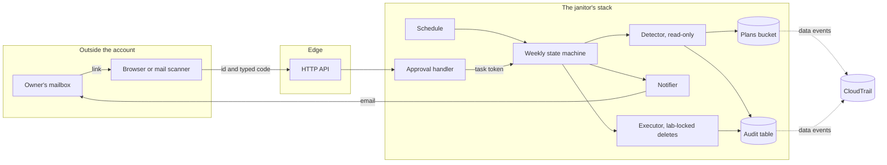

# Threat model

What this system protects, from whom, and where the protection ends. The role
table is read from the synthesized policies, not from intent, and the claims
about what an attacker cannot do are the ones the tests under
`tests/adversarial` try to break.

## What is protected

1. **The owner's resources, from wrongful deletion.** The janitor is the only
   thing in the account built to delete, so the question is always what it can
   be made to delete.
2. **The approval decision.** A deletion must follow a decision by the owner
   about a specific plan, and nobody else's.
3. **The record.** What was found, proposed, decided and done must stay as it
   was written.

## Who is considered

| Who | What they have |
| --- | -------------- |
| A stranger with an approval URL | The link from an approval email, by forwarding, a shared screen or a proxy log |
| Someone who can create or tag resources | Enough access to the account to launch or tag things, not to approve |
| Someone who can start executions or write the plans bucket | A foothold in the orchestration, without the approver's mailbox |
| A read-only insider | Read access to the audit table, the trail bucket or the execution history |
| The operator, by mistake | A typo in a deploy command, a mistyped tag, a click on the wrong button |

Not considered: an administrator of the account, who can change any of this,
and AWS itself. For both, the aim is that what they do leaves a trace.

## Where trust changes hands

Three crossings matter. The email leaves AWS and carries the authority to
approve. The HTTP API is the only thing reachable from the internet. And the
plan crosses from the detector to the executor through a bucket, by version
and hash, never through the state of the execution.

## The worst each role can do

Each row assumes the code of that component is fully under an attacker's
control, with the role it has today.

| Role | What it may do | Worst case |
| ---- | -------------- | ---------- |
| Detector | Describe and list calls in every region; write objects under `plans/`; put items under `RUN#`; query the `by-resource` index | Write a false plan and false findings, and replace audit items of earlier runs (see [The record](#the-record)). A false plan still has to be approved by the owner, the executor still re-checks every item against its live state, and IAM still refuses anything not lab-marked. It can read the inventory of the account. It cannot read approval records |
| Notifier | Read plans; publish to the reports and approvals topics; list their subscriptions; put and update items under `APPROVAL#` | Send the owner a misleading email, including a real approval link for a plan described falsely. Rewrite an approval record, including its status. It cannot resume an execution or invoke the executor, so a record it marks approved applies nothing by itself |
| Approval handler | Get and update items under `APPROVAL#`; `SendTaskSuccess` and `SendTaskFailure` on any task token | Approve any pending plan: it is the component that approves. What that deletes is bounded by the executor's checks and locks. The callback actions have no resource-level permissions, so with a token of another workflow in the account it could complete that task; it only ever reads tokens from approval records |
| Executor | Delete snapshots, volumes and addresses that carry the lab tag; delete dashboards, and deactivate and delete monitors, named with the lab prefix; never anything with the keep tag; describe calls; read plans; put items under `RUN#`; get items under `APPROVAL#`; put events on the default bus | Delete every lab-marked snapshot, volume (EC2 itself refuses one that is attached), address, dashboard and monitor in the allowed regions, plan or no plan, and replace audit items. Nothing else: no role holds an action that deletes or stops an instance, a database, a bucket, a cache or a load balancer. It can read a task token and cannot use it |
| Weekly state machine | Invoke the detector, the notifier and the executor; publish to the alerts topic; start the reminder machine; put items under `RUN#`; update items under `APPROVAL#`; the log-delivery actions Step Functions needs for its own logging, on any resource | Invoke the executor with an input of its choice. The executor still demands an approval record that reads approved, decided within the hour, for that run and that plan hash, and this role can write such a record. It can also replace audit items, and create, change or delete log deliveries in the account. This is the role to protect. Its definition is fixed at deploy time, and whoever can only start an execution chooses two values, `dryRun` and `minAgeDays` |
| Reminder state machine | Invoke the notifier | Invoke the notifier with a payload of its choice: send email in any of its modes, and create an approval record or replace the stored task token of a pending one. It cannot resume an execution |
| Scheduler role | Start the weekly state machine; send to the dead-letter queue | Start extra runs. Each still needs an approval |

Every function also carries the AWS managed policy that lets it write its own
logs.

Two things follow. The executor's IAM lock is the last line and it holds
whatever the other components do: the worst loss is lab-marked leftovers. And
"is in the approved plan" is a guarantee of code, not of IAM: the policy cannot
express it, so the executor never lists resources, applies only the items of
the plan it was pointed at, and checks that plan's hash against the approval.

## The approval channel

- **The mailbox is the authority.** Whoever receives the approval email can
  approve. Forwarding it delegates that. The approvals topic accepts publishes
  from the notifier only, and new subscriptions from the deployment role and
  the account root only.
- **The id can leak, it cannot be guessed.** It is a random version 4 UUID, and
  the API is throttled. It travels in a URL, so it can end up in a browser
  history or a proxy log, and inside the account it can be read from the audit
  table, CloudTrail and the execution history:
  [known limitations](known-limitations.md), section 1.
- **A scanner cannot approve.** `GET` writes nothing. A decision is a `POST`
  with four characters typed by a person. The page has no script. The code is
  shown on the page: it stops accidents, not someone who reads the page.
- **A decision happens once.** The record moves from pending to deciding with a
  conditional write before the execution is resumed, so two decisions cannot
  both win, and a decided or expired approval answers `409` or `410`.
- **An approval is good for an hour**, so an old one cannot be replayed
  ([ADR 0013](adr/0013-an-approval-is-good-for-one-hour.md)).
- **The stronger option exists.** With `approvalAuth=iam` the id decides
  nothing: the caller is authenticated with SigV4 and compared with one role.
  That is true of a caller who comes through the API. Someone who can invoke
  the function directly writes the event, and with it the caller:
  [known limitations](known-limitations.md), section 4.
- **A failed approval email is dropped, not stored.** The other two
  subscriptions send what SNS cannot deliver to the dead-letter queue. This one
  does not, because the queue would hold a working link for whoever can read it
  ([ADR 0015](adr/0015-approval-emails-are-not-redriven-to-a-queue.md)).
  That route is covered by tests and has not been used against the live API.

## The record

Tamper-evident, not tamper-proof.

- Run events are written once: a conditional put that fails if the item
  exists. That is a guarantee of code, like "is in the approved plan". IAM
  confines each function to one partition (`RUN#` or `APPROVAL#`; the weekly
  state machine writes to both) and lets no role delete an item, but it cannot
  require the condition: a role that may put items under `RUN#` could replace
  one if its code were changed.
- Plans are versions in a versioned bucket. The bucket policy denies deletion
  to everyone but the account root and writes to everyone but the detector.
  The executor reads the exact version that was approved and compares its hash.
- Nothing is kept forever. A plan expires after 400 days and a replaced
  version of one after 30. An approval record is removed 30 days after it
  expires; its outcome stays in the items of the run.
- CloudTrail records every read and write of the plans and of the table, by
  key, unless the stack was deployed with `createTrail=none`. It delivers them
  to a bucket of this stack that only the trail may write.
- An administrator can still change a policy, a lifecycle rule or the table.
  CloudTrail shows that they did. S3 Object Lock would be the next step for
  the plans.

## Releasing an address cannot be undone

A snapshot or a volume that is deleted is gone, but nothing outside the account
depended on it. An Elastic IP is different: once released it returns to AWS's
pool, and a DNS record or an allow-list elsewhere may still point at it. It is
the one deletable kind whose loss can break something the janitor cannot see.
An address is therefore proposed only when a live run finds it unassociated and
lab-tagged and an earlier live run, at least the minimum age before, recorded
the same. The address deleter has run against recorded responses only.

## What was tried

An adversarial pass on 2026-11-12 attacked the code from the first three
footholds above. Nothing made the executor delete outside an approved,
re-verified plan. Among what held: a keep tag added after the plan; fifteen
look-alikes of the lab tag; thirteen kinds of API error during verification;
a plan with an item appended or re-serialized; an approval of one run used with
the plan of another; approve and reject racing; twenty-three look-alikes of the
confirmation code; hostile names and reasons in the approval page; the task
token and the id in logs, errors and responses.

What broke was fixed the same day, or is written up as a limitation: the list
is in the follow-ups file under `docs/superpowers/plans/`, and
[ADR 0014](adr/0014-three-kinds-of-tests.md) says how the suite keeps it from
coming back.

A [security audit](evidence/security-audit-2026-11-18.md) on 2026-11-18 read
the source and ran it in a sandbox, without access to the account. It
confirmed nothing and left two leads about a second principal inside the
account. One was fixed (ADR 0015) and the other is limitation 4.

## What remains

- The approval id is readable inside the account
  ([known limitations](known-limitations.md), section 1).
- A direct invoke of the approval function can pass as the IAM approver
  (section 4). It needs `lambda:InvokeFunction` on that function.
- The audit was a partial pass. It did not review how the notifier trusts its
  event, which is the same family as section 4.
- With thousands of resources the detector and the executor run out of time
  writing their records (sections 2 and 3). They fail safe.
- The keep tag must match exactly; a mistyped one protects nothing.
- Not exercised against live AWS: the IAM approval route, the address and
  monitor deleters, the refusal to publish without a subscriber, and the IAM
  denies themselves, which were simulated against the policy engine and never
  seen on a live call.
- Not attacked by the adversarial pass: live AWS behaviour (which characters a
  tag accepts, how API Gateway decodes headers), the semantics of a Step
  Functions redrive, the other detectors, the reminder flow.
